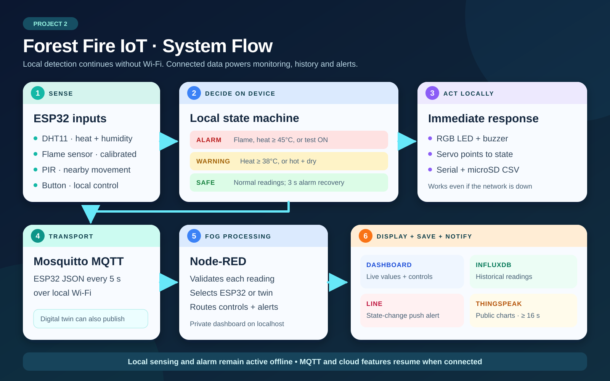
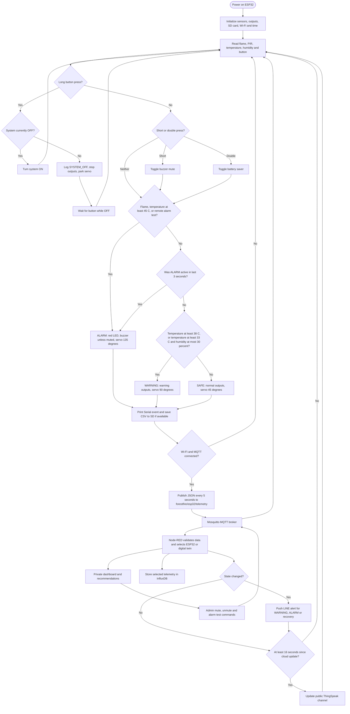

# Forest Fire IoT flowchart

[Download the PNG version](flowchart_infographic.png) for slides or the report.

This flowchart follows the firmware and Node-RED flow. GitHub renders the Mermaid diagram below directly in this page.

The physical alarm and SD logging continue if Wi-Fi is unavailable. The digital twin publishes the same JSON format on `forestfire/twin/telemetry`. Node-RED processes whichever source is selected on the private dashboard; only selected-source records go to InfluxDB, LINE and ThingSpeak.

Flame detection uses the board's calibrated `flame` result, so this diagram remains valid if the sensor's analog threshold or polarity is adjusted for the actual module. A failed DHT read does not create a heat alarm; flame detection still runs.
