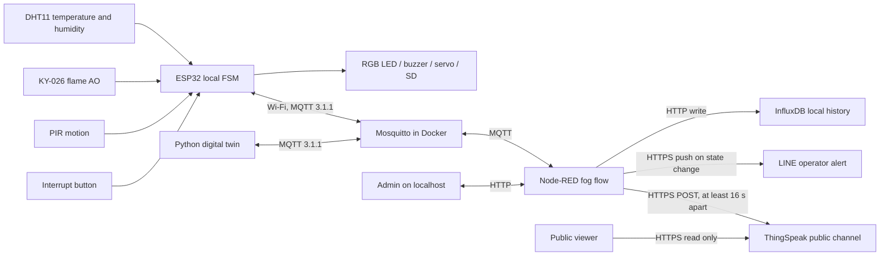
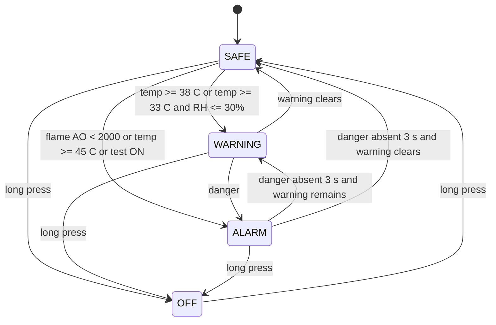

# Forest Fire Detection and Alert IoT System

## Group information

Replace with the group number, member names, photos, and date before submission.

## Objectives and operational scenarios

The project extends the Project 1 forest fire detector into an end-to-end IoT system. An ESP32 measures ambient temperature and humidity with a DHT11, infrared intensity with a KY-026 flame sensor, and nearby movement with a PIR sensor. It indicates SAFE, WARNING, or ALARM locally using an RGB LED, buzzer, and servo pointer. A physical interrupt-driven switch provides local control. The fog dashboard shows current measurements, risk state, a recommendation, device freshness, and remote controls. InfluxDB stores the time series, LINE sends state-change alerts to an operator, and a public ThingSpeak page gives internet users a view-only summary.

Scenario 1, heat and dryness: At 39 C and 25% humidity, with no flame, the system enters WARNING. The dashboard advises inspection, the LED becomes yellow, the buzzer chirps, and the servo points to 90 degrees. Scenario 2, flame or severe heat: With flame AO below calibrated 2000 or temperature at least 45 C, the system enters ALARM. The LED becomes red, the buzzer sounds, and the servo points to 135 degrees. PIR movement adds a person-near message. After danger clears for three seconds, the state returns to WARNING or SAFE. A short local press or admin button can mute the buzzer, but cannot clear the alarm state. A remote alarm test demonstrates actuation without dangerous heat or flame.

The digital twin publishes identical JSON messages to test logic and presentation without hardware. The physical device remains necessary for local, timely detection and actuation, including when the network fails. A general weather API cannot detect a nearby flame, a person at the site, or the actual temperature at the sensor position.

## Architecture and data flow

The ESP32 and twin have separate MQTT topics. Node-RED validates their common schema and displays the selected source. The fog flow stores the latest sample and up to 720 recent samples in memory, writes each selected sample to InfluxDB, computes operator recommendations, routes admin commands to the selected source, sends LINE alerts on state changes, and uploads eight numeric fields to ThingSpeak. The ESP32 also logs CSV to microSD, preserving readings when fog services are unavailable. InfluxDB and the SD card provide durable local history.

## State algorithm

The buzzer mute affects sound only. On a real deployment, allowing the local long-press button to turn the detector off during alarm would need a safety review. For this classroom prototype it preserves Project 1 behavior. DHT errors do not create false temperature alarms; the flame sensor remains active. The flame threshold requires calibration under actual lighting, because the KY-026 analog response varies.

## Circuit and hardware

Use `docs/hardware_wiring.svg` and `docs/HARDWARE_WIRING.md` for the complete Project 2 wiring. The original Project 1 Fritzing schematic is historical: it includes the now-removed TFT and omits the PIR. DHT11 is on GPIO4; flame AO on GPIO34; PIR on GPIO27; button on GPIO13; active buzzer on GPIO26; RGB LED on GPIO25/33/32; servo on GPIO21; SD CS on GPIO22; SD SPI SCK/MOSI/MISO on GPIO18/23/19. GPIO5/16/17 are unused. All other pins stay as in Project 1. Verify common ground and power the servo from a suitable external regulated 5 V supply.

## Protocol and technology choices

MQTT 3.1.1 on local Wi-Fi is appropriate for low-bandwidth, frequent telemetry and bidirectional commands. QoS 0 keeps the loop responsive and avoids delivery queues; retained telemetry gives a newly opened dashboard the last sample, while the freshness indicator marks it stale after 15 seconds. Commands are not retained, so a reconnect does not replay an old actuation request. The ESP32 publishes every five seconds. JSON makes the schema easy to inspect and reuse in the twin, at the cost of more bytes than a binary format. Mosquitto, Node-RED, and InfluxDB are in local Docker containers, providing a fog layer that can process and store data even when the public cloud is unavailable. LINE receives authenticated HTTPS pushes only when a risk state changes. ThingSpeak receives HTTPS updates no more often than every 16 seconds and exposes only view access to public users.

Standard 2.4 GHz Wi-Fi is practical for the existing ESP32 and classroom LAN. LoRaWAN would offer longer range and lower power for remote forests but requires a compatible radio and gateway, has much lower throughput, and is less suitable for rapid interactive control. For a deployment away from campus Wi-Fi, a dedicated long-range network or cellular backhaul would be preferable. This prototype reduces CPU frequency in OFF or SAFE battery mode and slows noncritical updates, but Wi-Fi remains active for remote monitoring, so it does not claim deep-sleep power savings. Servo movement uses timed steps; sensing and MQTT retries do not block the loop. Initial NTP sync and the Project 1 power-off servo sweep still block briefly.

## Analytics and control

Thresholds are applied on the ESP32, so the physical alarm is independent of cloud and broker availability. The twin mirrors the same thresholds. Node-RED provides descriptive recommendations based on state and marks samples stale after 15 seconds. Admin buttons issue `MUTE`, `UNMUTE`, `TEST_ON`, and `TEST_OFF`. The command callback accepts exact strings only and does not offer a command to force a safe state. In normal use, `TEST_ON` should be followed by `TEST_OFF`.

## Private dashboard and public view

The private dashboard is `http://localhost:1880/ui`, with temperature, humidity, flame, state, recommendation, freshness, source selector, and control buttons. InfluxDB provides local historical charts at `http://localhost:8086`. Both are bound to localhost in Docker Compose. LINE Messaging API sends an operator alert on WARNING, ALARM, and recovery; the flow builds authenticated HTTPS requests using values from ignored `.env`. The public dashboard is a ThingSpeak channel configured for public read access with fields: 1 temperature C, 2 humidity %, 3 flame flag, 4 motion flag, 5 state code (OFF=0, SAFE=1, WARNING=2, ALARM=3), 6 flame AO, 7 servo degrees, 8 muted flag. The public URL and real screenshots must be inserted after channel creation. The write API key stays in local `.env`.

## Results and limitations

Automated twin checks confirm SAFE -> WARNING -> ALARM -> delayed SAFE recovery, and remote test/mute behavior. The flow JSON was generated and parsed locally. Actual ESP32 actuation, InfluxDB writes, LINE delivery, Docker UI, ThingSpeak updates, and real-world sensor thresholds still require the group to run the live checks in `docs/DEMO.md`. Do not present simulated values as physical measurements. Replace this paragraph with measured outcomes and screenshots after the demo.

## Self assessment and version history

Add the group's evidence-based score and a brief reflection after hardware and cloud verification. Suggested version table: V0.1, 2026-11-24, implementation draft; V1.0, submission date, verified release. Add each member's contribution accurately.
